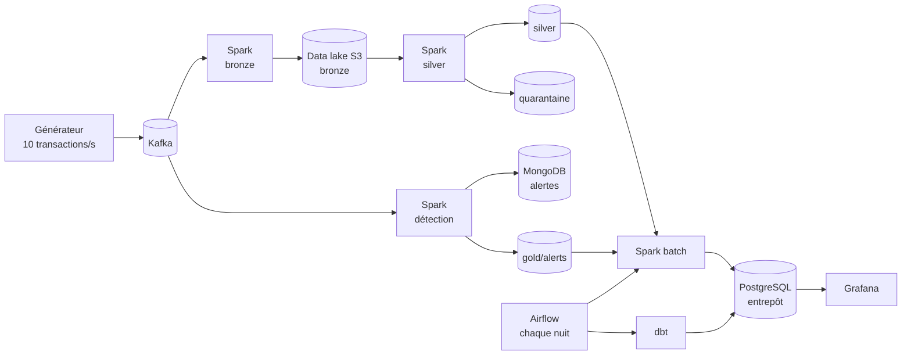

# FraudFlow

[](https://github.com/aminetig/fraudflow/actions/workflows/ci.yml)

Plateforme de données qui détecte la fraude à la carte bancaire en temps réel. Des transactions arrivent en continu dans Kafka. Spark les contrôle, masque les numéros de carte et lève une alerte en quelques secondes quand un comportement est suspect. Chaque nuit, Airflow charge la journée dans un entrepôt PostgreSQL que dbt transforme en tables métier testées, affichées dans Grafana.

> Projet personnel de data engineering. Toutes les données sont simulées : aucun numéro de carte réel n'est utilisé.

## Architecture



Le détail se trouve dans [docs/architecture.md](docs/architecture.md).

## Ce que montre le projet

| Compétence | Dans FraudFlow |
| --- | --- |
| Streaming | Kafka en mode KRaft, et 6 requêtes Spark Structured Streaming qui reprennent après une panne sans perte ni doublon |
| Traitement distribué | PySpark en continu (fenêtres, watermark, état) et en lots (chargement quotidien) |
| Architecture data lake | Couches bronze, silver et gold en Parquet sur un stockage compatible S3 (MinIO) |
| Bases relationnelles et NoSQL | PostgreSQL pour l'entrepôt en étoile, MongoDB pour les alertes à structure variable |
| ELT | dbt : modèles staging, intermediate et marts, tests de données, documentation et lignage |
| Orchestration | DAG Airflow 3 idempotent, avec rejeu, nouveaux essais automatiques et seuil qualité bloquant |
| Qualité et gouvernance | 9 contrôles avec quarantaine motivée, tests dbt, pseudonymisation PCI DSS des cartes, colonnes sensibles marquées |
| Supervision | Métriques de chaque micro-batch, 2 tableaux de bord Grafana, une alerte d'arrêt du flux, un runbook |
| CI/CD | GitHub Actions : style du code, tests PySpark, `dbt build` sur un PostgreSQL de test, construction des images |

## Démarrage rapide

Prérequis : Docker Desktop, avec au moins 4 Go de mémoire pour Docker, et `make`.

```bash
make up          # première fois : environ 10 minutes, pour construire les images
```

La plateforme temps réel démarre : Kafka, générateur, MinIO, PostgreSQL, MongoDB, Spark et Grafana. Le fichier `.env` des secrets est créé à partir de `.env.example`.

| Service | Adresse |
| --- | --- |
| Grafana, tableaux de bord | http://localhost:3000 |
| Spark UI, traitements en continu | http://localhost:4040 |
| Console MinIO, data lake | http://localhost:9001 (identifiants dans `.env`) |
| Airflow, après `make batch` | http://localhost:8081 |
| Documentation dbt, après `make dbt-docs` | http://localhost:8082 |
| Kafka UI, après `make ui` | http://localhost:8080 |

Commandes utiles :

```bash
make alerts       # dernières alertes de fraude
make lake-report  # bilan du data lake : pertes, doublons, quarantaine
make evaluate     # précision, rappel et délai de la détection
make batch        # traitement quotidien : met Spark en pause et lance Airflow
make streaming    # revient au temps réel : Spark rattrape son retard
make help         # toutes les commandes
```

Sur une machine de 8 Go, le temps réel et Airflow ne tiennent pas ensemble en mémoire : `make batch` et `make streaming` alternent les deux. Avec 16 Go, `docker compose --profile batch up -d` lance tout.

## Résultats mesurés

Mesures réelles, sur un PC portable de 8 Go de RAM, avec Docker limité à 3,76 Go.

| Mesure | Résultat |
| --- | --- |
| Débit | 10 transactions par seconde, sans retard, pour 6 requêtes Spark en parallèle |
| Reprise après panne | Spark coupé net (`kill`) pendant 60 s, puis relancé : 53 821 messages Kafka présents **exactement une fois** dans le bronze (0 doublon, 0 trou) |
| Bilan bronze → silver | bronze = silver + quarantaine + doublons supprimés, à la ligne près (53 821 = 52 531 + 1 044 + 246) |
| Quarantaine | 1,95 % des lignes, avec leur motif de rejet (12 motifs observés) |
| Numéros de carte en clair dans le data lake | 0, vérifié par `make lake-report` |
| Rejeu d'une journée par Airflow | chiffres identiques au centime près, aucun doublon |
| Alerte « plus de données » | déclenchée 10 minutes après l'arrêt du flux, levée à sa reprise |
| Panne réelle | Kafka saturé, sans réponse pendant 60 s : la requête bronze s'arrête, Docker relance Spark, qui reprend depuis ses checkpoints |
| Tests | 52 tests pytest, et `dbt build` : 11 modèles et 33 tests de données sans erreur |
| Détection de fraude | voir ci-dessous |

### Qualité de la détection

`make evaluate` compare les alertes aux fraudes injectées par le générateur, une vérité terrain que la détection ne lit jamais. Mesures sur 4 heures de flux continu.

- **Rappel :** part des transactions frauduleuses couvertes par une alerte.
- **Précision :** part des alertes qui concernent bien une fraude.

| Règle | Rappel | Précision | Explication |
| --- | --- | --- | --- |
| R1 rafale | 95,5 % (1 581 / 1 656) | 98,8 % (241 / 244) | |
| R2 montant anormal | 100 % (308 / 308) | 99,8 % (507 / 508) | |
| R3 voyage impossible | 93,4 % (428 / 458) | **61,1 %** (206 / 337) | Les fausses alertes sont des achats frontaliers légitimes (France puis Belgique en 20 minutes), simulés exprès : la règle ne distingue pas un pays voisin d'un pays lointain. Amélioration prévue : tenir compte de la distance entre les pays |
| R4 commerçant à risque la nuit | 100 % (175 / 175) | 91,8 % (178 / 194) | Les fausses alertes sont de vrais gros achats nocturnes de clients aisés |

**Délai d'alerte**, entre la transaction suspecte et l'alerte enregistrée dans MongoDB, en régime normal (55 alertes sur 10 minutes) :
- médiane : **10,5 s** ;
- 95 % des alertes en moins de 44 s ;
- maximum : 54 s.

Sur ce PC, 6 requêtes se partagent 3 cœurs, et chaque micro-batch de détection prend 10 à 25 s. Après une pause, le délai monte à quelques minutes, le temps que Spark rattrape son retard.

## Qualité et sécurité des données

- **Pseudonymisation :** dès le bronze, le numéro de carte est remplacé par une empreinte SHA-256 salée et ses 4 derniers chiffres. Toute suite de 13 à 19 chiffres est aussi masquée dans le message brut, même dans un JSON cassé.
- **Quarantaine :** chaque ligne invalide est gardée avec son motif, plutôt que perdue. Les contrôles ont lieu avant le watermark, pour qu'une date aberrante ne fasse pas jeter les vraies données.
- **Seuil bloquant :** au-delà de 5 % de quarantaine, le DAG s'arrête avant dbt, et les tables métier gardent leur dernière version saine.
- **Tests :** 52 tests pytest, et 33 tests de données dbt (unicité, relations, valeurs acceptées, fraîcheur, cohérence alertes / transactions).
- **Secrets :** dans `.env`, jamais versionné, et transmis aux conteneurs par Airflow sans être affichés.

## Structure du dépôt

```
├── generator/         # simulateur : référentiel, transactions, fraudes, anomalies, producteur Kafka
├── spark/
│   ├── lib/           # fonctions pures et testées : masquage, contrôles qualité, règles de fraude
│   ├── jobs/          # traitements en continu, chargement quotidien, évaluation, bilans
│   └── tests/
├── dbt/fraudflow/     # modèles staging, intermediate et marts, tests, seeds de la CI
├── airflow/dags/      # DAG quotidien
├── monitoring/grafana/# source de données, tableaux de bord et alerte, versionnés
├── infra/             # schéma PostgreSQL, script MongoDB
├── docs/              # architecture, runbook, choix techniques, dictionnaire, journal
├── docker-compose.yml
├── Makefile
└── .github/workflows/ci.yml
```

## Documentation

- [Architecture](docs/architecture.md) : flux, règles de fraude, modèle de l'entrepôt
- [Runbook](docs/runbook.md) : que faire quand ça casse
- [Choix techniques](docs/decisions.md) : 8 décisions, chacune avec l'alternative écartée
- [Dictionnaire de données](docs/data_dictionary.md)
- [Journal](docs/journal.md) : les problèmes rencontrés et leur solution

## Limites et améliorations

- **Un seul nœud partout :** Kafka n'a qu'un broker, sans réplication, et Spark tourne en mode local. En production : 3 brokers, et Spark sur un cluster (Kubernetes, EMR, Databricks).
- **Sécurité minimale en local :** Kafka n'est pas chiffré, les comptes sont des comptes administrateurs, et Airflow est ouvert sans connexion. En production : TLS, comptes à droits limités, et secrets dans un coffre-fort (Vault, AWS Secrets Manager).
- **Petits fichiers :** chaque micro-batch crée des fichiers Parquet. Une compaction quotidienne, ou Delta Lake (`OPTIMIZE`), serait nécessaire sur la durée.
- **Schémas :** le format des messages est implicite. Un registre de schémas (Avro, Protobuf) protégerait des changements en amont.
- **Règles simples :** 4 règles fixes. R3 confond les achats frontaliers avec des voyages impossibles (61 % de précision). La suite naturelle serait de tenir compte des distances, puis d'entraîner un modèle de machine learning sur l'historique, avec ces règles comme garde-fous.
- **Fraude de nuit :** elle n'est injectée qu'entre 0 h et 5 h, heure de Paris. En journée, la règle R4 ne voit donc rien.

## Licence

[MIT](LICENSE)
