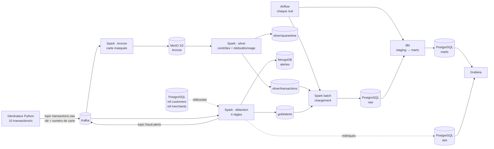
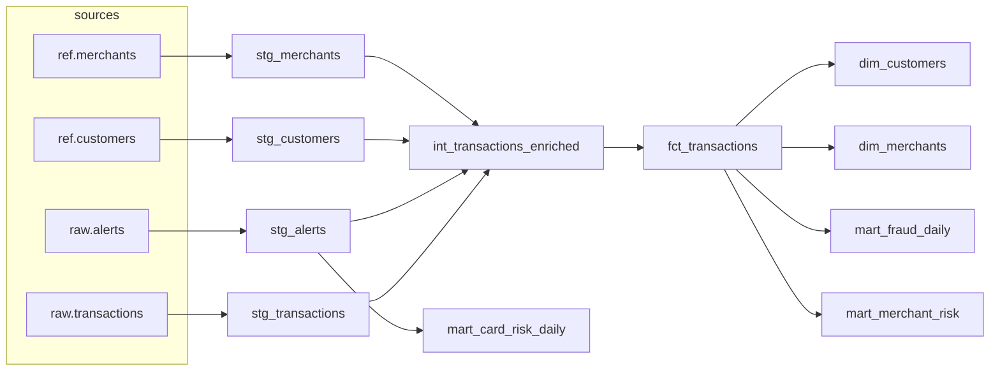

# Architecture

## Vue d'ensemble

Deux chemins répondent à deux besoins :

- **Le temps réel** (en continu) : chaque transaction passe par Kafka puis Spark. Elle est rangée dans le data lake et contrôlée, et une alerte part en quelques secondes si elle est suspecte.
- **Le batch** (chaque nuit) : Airflow charge la journée dans l'entrepôt PostgreSQL. Il s'arrête si trop de lignes ont été rejetées, puis lance dbt, qui construit les tables métier lues par Grafana.

## Les traitements en continu

Six requêtes Spark tournent dans une seule application, donc une seule machine Java, plus économe en mémoire. Chacune a son propre checkpoint.

| Requête | Lit | Écrit | Déclenchement |
| --- | --- | --- | --- |
| `bronze` | Kafka | `s3a://bronze/transactions`, partitionné par jour d'arrivée | 30 s |
| `silver` | bronze | `s3a://silver/transactions`, partitionné par jour de transaction | 30 s |
| `quarantine` | bronze | `s3a://silver/quarantine`, avec `rejection_reason` | 30 s |
| `fraud_burst` | Kafka | alertes R1 | 10 s |
| `fraud_travel` | Kafka | alertes R3 | 10 s |
| `fraud_instant` | Kafka | alertes R2 et R4 | 10 s |

**Reprise après panne :** le checkpoint garde les offsets Kafka déjà traités et l'état des fenêtres. Les fichiers Parquet sont écrits avec un journal de validation (`_spark_metadata`), et les alertes par upsert. Une panne ne provoque donc ni perte ni doublon. C'est testé : arrêt brutal (`kill`), 60 secondes de coupure, puis vérification offset par offset.

## Les règles de fraude

| Règle | Détecte | Mécanisme Spark |
| --- | --- | --- |
| R1 rafale | 5 paiements ou plus sur une carte en 2 minutes | fenêtre glissante de 2 min, décalée d'1 min, mode `update` |
| R2 montant anormal | plus de 10 fois le montant habituel du client | jointure flux / table avec le référentiel |
| R3 voyage impossible | 2 pays en moins de 30 minutes, carte présente (magasin ou distributeur) | fenêtre glissante de 30 min, décalée de 5 min |
| R4 commerçant à risque la nuit | au moins 300 € entre 0 h et 5 h (heure de Paris) chez un commerçant à risque | jointure avec le référentiel, conversion de fuseau |

Chaque alerte a un score de 0 à 100 et un niveau (LOW, MEDIUM, HIGH). Les alertes d'une même fraude sont regroupées en un incident (voir [decisions.md](decisions.md)). Dans l'entrepôt, `mart_card_risk_daily` combine les scores de toutes les règles d'une carte sur une journée.

## Le modèle de l'entrepôt

C'est un modèle en étoile : `fct_transactions` est la table de faits, `dim_customers` et `dim_merchants` sont les dimensions. Les marts répondent chacun à une question métier. Le lignage complet est visible avec `make dbt-docs`.

## Qualité des données, à quatre niveaux

1. **À l'entrée du silver :** 9 contrôles (JSON lisible, champs obligatoires, montant positif, devise et pays ISO, canal connu, date valide et pas dans le futur). Chaque ligne rejetée part en quarantaine avec son motif.
2. **Dans l'entrepôt :** tests dbt (unicité, valeurs non nulles, relations, valeurs acceptées, montant positif, fraîcheur des sources), et un test spécifique : chaque alerte pointe vers une transaction connue.
3. **Dans Airflow :** un seuil bloquant. Au-delà de 5 % de quarantaine, dbt n'est pas lancé.
4. **Dans Grafana :** supervision du débit et du taux de quarantaine, et une alerte si plus rien n'arrive depuis 10 minutes.

## Données personnelles

- **Numéro de carte :** jamais stocké en clair dans le data lake ni dans l'entrepôt (empreinte salée et 4 derniers chiffres). Il ne transite en clair que dans Kafka, comme depuis un système de paiement.
- **Nom et e-mail des clients :** seulement dans le référentiel, marqués `pii: true` dans dbt.
- **Secrets :** dans `.env`, jamais versionné. Airflow les transmet aux conteneurs sans les afficher (`private_environment`).
